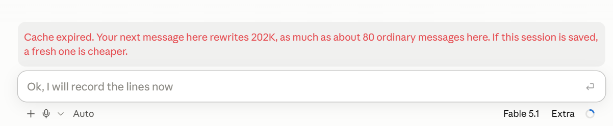
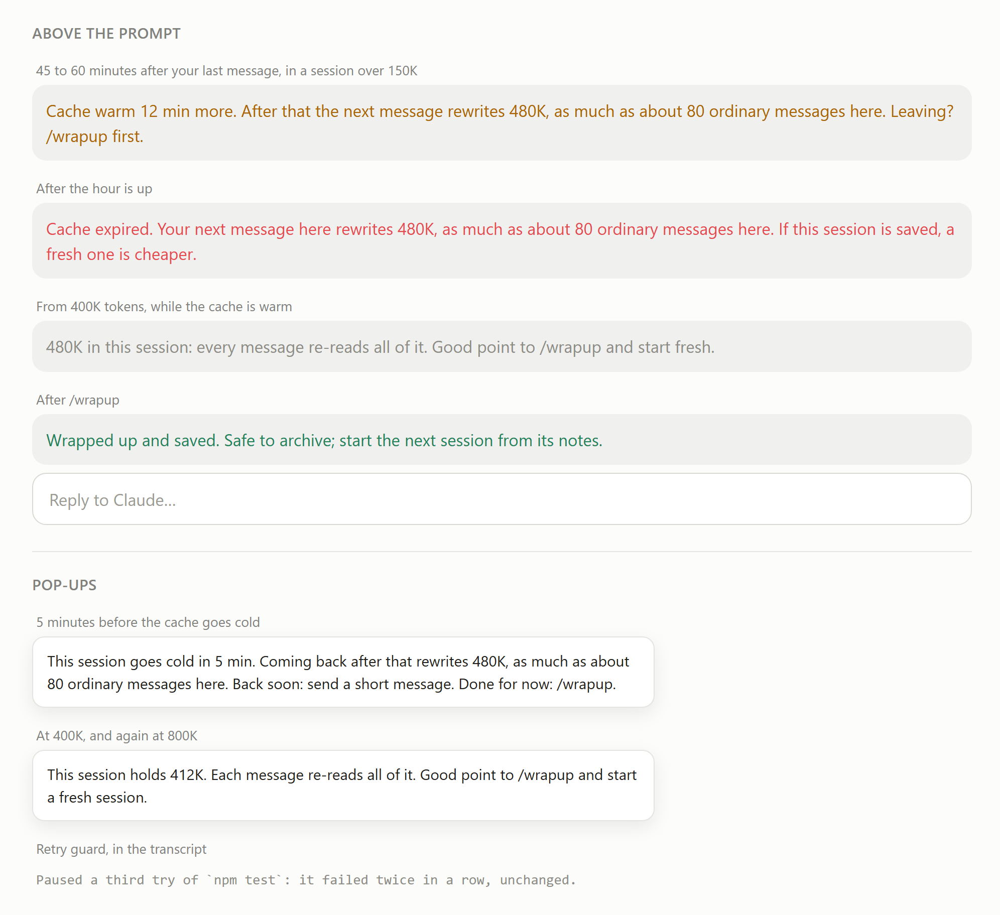

# Session Guardian

A Claude Code plugin and two CLAUDE.md rules that keep long sessions cheap to run and easy to
pick up again.



## Why

In a long Claude Code session, most of your usage doesn't go to Claude writing code. It goes to
Claude re-reading the conversation, on every message. That re-reading is cheap while the
conversation is cached, and the cache lasts an hour after your last message (on a Claude
subscription, for the main conversation). Come back later and your first message writes the
whole conversation into the cache again, at twice the normal input price.

In one heavy user's month of logs, about 15% of all usage went to these cold returns. A fresh
session that reads a short tracker file cost about as much as eight messages in a very large
session, and every message after that was far cheaper.

Session Guardian shows you the expensive moments before they happen, and makes starting fresh
safe.

The habits behind it fit on two pages: [Claude Code good practices (PDF)](docs/claude-code-good-practices.pdf),
free to share.

## What the plugin does

- **Countdown before the cache goes cold.** For sessions over 150K tokens, a line above the
  prompt counts down the last 15 minutes and says what coming back after that will cost. One
  pop-up comes 5 minutes before.
- **Wrap-up nudge.** At 400K tokens, and again at 800K, a pop-up suggests wrapping up and
  starting fresh.
- **Autosave.** When a session has been quiet for 50 minutes and you asked it something since
  its last save, Session Guardian asks Claude to save where it stopped (in `TRACKER.md`, or
  wherever your CLAUDE.md rules say) while the cache is still warm. A save is usually 2 to 5
  warm messages (measured on 16 Oct 2026: $0.22 on a 472K Opus 5.5 session, $0.13 on a 138K
  one), about 6% to 12% of the cold return it heads off, and it keeps the cache warm for another
  hour. Come back hours later and a fresh session can pick up from the notes, even if you never
  ran `/wrapup`. It happens once per quiet stretch, only in sessions over 20K tokens, never
  while Claude is still working, and the line above the prompt then says when it saved. When
  your last turn already ended by writing the notes (`TRACKER.md`, `SESSIONS.md` or a
  `*HANDOVER*.md`, then nothing but renaming the session or setting its markers), there is
  nothing new to save and none is sent.
- **`/wrapup`.** Claude saves where the session stopped (in `TRACKER.md`, or wherever your
  CLAUDE.md rules say), marks the session done and gives you a one-line prompt to start the
  next one. The line above the prompt then says it's safe to archive.
- **Retry guard.** When the same Bash or PowerShell command fails twice in a row with no edit
  in between, the third identical try is paused once and Claude is asked to fix the cause
  first. Sending the same command again runs it.
- **Dead ends saved with `/wrapup`.** Every command that failed twice in a row unchanged is
  remembered, with its error line and the next command of the same program that worked (so
  `npm run test:unit` after a failing `npm test`). Edits and compaction don't clear the list.
  `/wrapup` hands it to Claude, who writes one line per dead end into the saved notes, or into
  the project's CLAUDE.md when it is a lasting fact, so the next session doesn't try the same
  thing again.

Costs are shown in ordinary messages: a cold return of a Fable 5.1 session costs as much as
about 80 warm messages, Opus 5.5 about 40, Sonnet about 20. If you set `weeklyUsd`, they are
also shown as a share of your weekly limit.

## What it looks like

The screenshot at the top is the red band in the desktop app, on a real 202K session whose cache
had just expired. The figure below shows every state with the plugin's exact wording, laid out
in the same style (a mock-up, not a screenshot). In the terminal the band shows the same text in
your terminal's colours.



## What it saves

An early estimate, from one heavy user's logs (Max 20x, mostly Fable 5.1 and Opus 5.5), priced
at API list prices with [the benchmark script](#measuring-whether-it-helps):

| | 27 Sep to 9 Oct, before | 10 to 11 Oct, first two days with it |
| --- | ---: | ---: |
| Cold returns in interactive sessions | 175 | 2 |
| What they cost | $732 | $9 |
| Share of interactive usage | 20.4% | 4.2% |

A cold return cost $4.18 on average (334K rewritten), and the largest, on 600K to 720K Fable
sessions, $12 to $15 each. A fresh session's first message, reading a tracker file, cost a
median of $0.37. At the earlier rate of about 13 cold returns a day, swapping them for fresh
starts saves about $50 a day at API prices, which is 15% to 20% of a week that fills a Max 20x
limit. Put another way: about one day of usage back each week.

Two days is a small sample, and those two were a weekend after the weekly limit had been hit,
so usage was light. Re-run the script after a few weeks before you trust the figure. One
automated session is left out of both columns: a background loop that woke every 110 minutes
and so came back cold every time (85% of its usage). The fix there is to wake it more often
than once an hour, which needs no plugin.

## The rules

`rules/CLAUDE.md` holds two rules for Claude and one optional one. They work with or without the
plugin.

- **Session ID and sidebar markers.** Every session takes a number from `SESSIONS.md` and
  renames itself, like `#W4 Website · contact form`. A marker in front of the title says where
  it stands: `@` waiting on you, `✓` done, `!` blocked.
- **Branch and Progress Tracker.** Every project that runs over more than one session keeps a
  `TRACKER.md`. The five latest sessions sit at the top, and each one edits only its own line,
  so sessions running side by side don't overwrite each other. Below that come what waits on
  you and the branches of work, next step first. Finished items stay struck out as a reminder,
  five at most; older lines move to `TRACKER-ARCHIVE.md`.

- **TLDR on long replies (optional).** A long final reply ends with one or two plain lines:
  what was done, what comes next, what waits on you. It costs a little output, but when you come
  back to a session lost, the last message tells you where things stand, and you can start fresh
  from it instead of asking the old session.

Renaming and the sidebar markers use tools of the Claude desktop app. Elsewhere Claude writes
the ID in its first line instead.

## Install

The plugin needs a Claude Code version with function-hook plugins, which are early access. It
was built and tested on Claude Code 2.1.289.

From a terminal:

```bash
claude plugin marketplace add A-rdit/session-guardian
claude plugin install session-guardian@session-guardian
```

Or inside a Claude Code session in the terminal:

```
/plugin marketplace add A-rdit/session-guardian
/plugin install session-guardian@session-guardian
```

It then loads in every new session, in the terminal and in the desktop app.

For the rules, copy the two sections of `rules/CLAUDE.md` into `~/.claude/CLAUDE.md` for every
project, or into one project's `CLAUDE.md` to try them there first.

## Settings

| Setting | Default | What it does |
| --- | --- | --- |
| `warnMinutes` | 5 | How many minutes before the cache goes cold the pop-up comes |
| `warnFromTokens` | 150000 | Sessions smaller than this get no countdown |
| `wrapupAt` | 400000 | Size of the first wrap-up nudge; the second comes at twice this |
| `weeklyUsd` | 0 (off) | Your weekly limit in API dollars, to show costs as a share of your week |
| `retryGuard` | true | Pause the third identical failing command once |
| `deadEnds` | true | List commands that kept failing in the `/wrapup` prompt |
| `autoSaveMinutes` | 50 | Minutes of quiet before the autosave; 0 turns it off, at most 58 |

Change them with `/plugin configure session-guardian@session-guardian` in a terminal session,
or pass them when installing: `claude plugin install session-guardian@session-guardian --config weeklyUsd=1770`.
They are stored under `pluginConfigs` in `~/.claude/settings.json`.

To find your `weeklyUsd`, take a week that filled your weekly bar and add up what its usage
would have cost at API prices. A usage tool such as
[optimAIzr](https://github.com/blendbunjaku/optimaizr) can show that figure. On a Max 20x plan in
October 2026, one such week came to about $1,770.

## How the numbers are worked out

- The plugin reads the session's context size and model from Claude Code itself. It makes no
  network calls and writes no files itself; the autosave asks Claude to write the notes.
- A cold return writes the whole context into a 1-hour cache at twice the model's input price.
  A warm message reads it at the cache-read price. The ratio of the two is the "ordinary
  messages" figure.
- Prices are Anthropic's list prices of October 2026, in `plugin/hooks/register.tsx`.

## Limits

- Pop-ups and the countdown show only in that session's own window. A session running in the
  background warns nobody until you open it.
- It assumes the 1-hour cache Claude Code uses for the main conversation on a subscription.
  Subagents use a 5-minute cache and are left out. If your account moves to a shorter cache,
  for example while it draws on pay-as-you-go extra usage, the countdown is too generous.
- The share of your week assumes your limit drains in line with API prices. Anthropic doesn't
  publish how limits are counted, so treat it as a guide.
- The retry guard and the dead ends go by whether the command failed. A piped command such as
  `npm test | tail` reports the last program's result, so a failing test run behind a pipe
  counts as a success.
- The dead-end list lives in memory: reloading the plugin or restarting the app starts it over.
  The "seen working" hint is a guess from the program name, and Claude is asked to correct it.
- The autosave arrives in the session as a message from you, so you see it in the chat. The app
  has to be open for it to run, and a session the app has unloaded is not saved. If you happen
  to be typing in that session at the 50-minute mark, the save goes in first.
- After `/reload-plugins` or an app restart the plugin doesn't know when a session's last
  request was, so a session that is already quiet then is not autosaved until its next turn.
- The autosave knows the notes by their file names. Notes kept under another name are not
  recognised, so a turn that ends by writing them still gets a save.

## Development

```bash
claude plugin validate plugin
claude plugin test plugin
```

The tests in `plugin/tests` cover the countdown, the nudges, `/wrapup`, the autosave, the retry
guard, the dead ends and the band on the terminal and desktop surfaces.

## Measuring whether it helps

`bench/cold-returns.py` reads your own Claude Code transcripts (`~/.claude/projects`) and prices
every request of the main conversation at list prices. A cold return is a request more than an
hour after the previous one in the same session, when the whole context is written into the cache
again. The script reports, per week, how much of your usage those cost; how big cold returns
are, split into what was rewritten and what was still cached, with their spread by size; and
the most expensive ones. Nothing leaves your machine.

```bash
python bench/cold-returns.py --since 2026-09-01 --weeks 8
```

Run it once before you install Session Guardian and again a few weeks later; the cold share is
the number that should fall. On Windows, set `PYTHONIOENCODING=utf-8` first if session titles
contain characters your console can't print. Over two months of one heavy user's logs, 18.6% of
all usage was cold returns, rising to 24% in the last two weeks as sessions grew.

## Credits

The cache countdown and the retry guard were inspired by
[optimAIzr](https://github.com/blendbunjaku/optimaizr), a local tool that finds wasted tokens in
Claude Code and Codex. Session Guardian is a smaller, separate take, focused on the desktop app
and on handing work from one session to the next. The dead ends follow an idea from
[MuscleMemory](https://github.com/TheWariend/MuscleMemory), which turns failed attempts into
"watch out" notes for the next run.

## License

[MIT](LICENSE)
